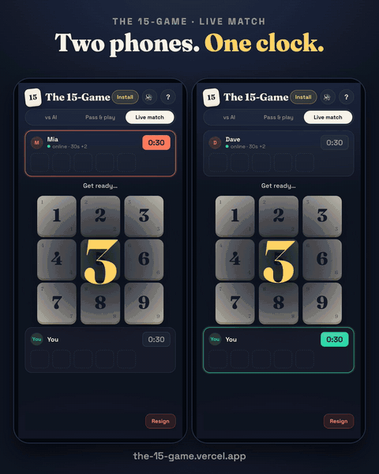

# The 15-Game

Take turns claiming numbers 1–9. First to hold **three that add up to exactly 15** wins.

**Play at https://the-15-game.vercel.app**

<a href="https://the-15-game.vercel.app"></a>

- **vs AI** on Easy, Medium or Hard. Hard never loses, and among its best moves it picks the
  ones most likely to trip up a human
- **Pass & play** on one device
- **Live match:** send a challenge link for a timed game (15s+1, 30s+2 or 60s+3 per player), or
  challenge a recent opponent directly. Challenges and rematch requests pop up wherever the other
  player is in the app, and arrive as push notifications when it's closed
- Coaching for new players (the rules and the sums, not the strategy) and a one-line insight
  after each game
- Share a picture of the final board
- Installable as an app, playable offline against the AI, with sound effects and haptics

## Development

```sh
npm install
npm run dev      # local dev server
npm run build    # type-check + production build to dist/
```

Code layout: `src/game` (rules, AI and post-game analysis), `src/local.ts` (offline game state),
`src/online` (Firebase wrapper, clock maths, the match state machine in `match.ts`, opponents and
inbox in `social.ts`, Web Push in `push.ts`), `src/view.ts` (derives what the board shows) and
`src/ui` (DOM rendering, sounds, share image). All rendering is derived from small stores.

## Online play

Live matches use Firebase Realtime Database with anonymous sign-in. There is no game server:
`database.rules.json` enforces turns, legal cards, the chess clock (checked against server time)
and results, so a client can't move out of turn, add time or fake a win. Each player also has a
private opponents list and an inbox; you can only send challenges to people you've played, and
direct challenges can only be accepted by their invitee. Identity is anonymous and per-browser,
so clearing site data resets your opponents list.

The rules are generated, so edit the generator rather than the JSON:

```sh
python3 scripts/gen-rules.py
firebase deploy --only database
```

The Firebase web config in `src/online/firebase.ts` is public by design; access is controlled by
the rules, and the API key is restricted to this site's domain.

## Push notifications

`api/notify.js` is a Vercel function that sends a Web Push when a challenge lands in someone's
inbox. It reads the database with the sender's own Firebase ID token, so the rules decide whether
the invite exists and whether the sender may read the recipient's push subscriptions. It needs
`VAPID_PUBLIC_KEY` and `VAPID_PRIVATE_KEY` in the Vercel environment; the private key is never
committed. On iOS, notifications require the app to be added to the home screen.
